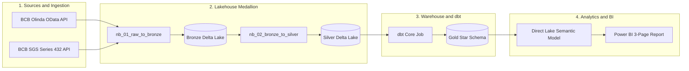

# Focus Market Intelligence

> **End-to-end enterprise analytics platform on Microsoft Fabric and dbt for monitoring and modeling Central Bank of Brazil (BCB) macroeconomic expectations.**

[Português](./README.md) | **English**

[](https://fabric.microsoft.com/)
[](https://getdbt.com/)
[](https://powerbi.microsoft.com/)
[](https://spark.apache.org/)
[](https://dadosabertos.bcb.gov.br/)
[](./LICENSE)


---

## Project Overview

**Focus Market Intelligence** is an Analytics Engineering solution built to ingest, clean, model, and serve macroeconomic expectation data published via the Central Bank of Brazil (BCB) open APIs, delivering decision-grade market intelligence for macroeconomic research desks, treasury operations, asset managers, and executive leadership.

The solution addresses three core business requirements:
1. **Continuous Ingestion Pipeline:** Automated daily ingestion of macroeconomic consensus forecasts via the Olinda OData API and official interest rates through the SGS Time Series API.
2. **Governance via Medallion Architecture and dbt:** Progressive data refinement across Lakehouse layers and dimensional star schema modeling within Fabric Warehouse using dbt Core tests for schema, uniqueness, and reference integrity.
3. **Executive Storytelling and Economic Rigor:** A 1920x1440 canvas Power BI executive report applying the exact nonlinear **Fisher Equation** without linear approximations, coupled with institutional comparison between **Market Consensus** and the **Top 5 forecasters**.

---

## End-to-End Data Architecture



### Direct Lake Semantic Model (Star Schema)

The dimensional and fact tables created by dbt in the Fabric Warehouse are served by the `sm_focus_market_intelligence` semantic model in **Direct Lake** mode, structured as a clean Star Schema:


---

## Dashboard Structure (3 Executive Reports)

The Power BI report is organized into three complementary executive screens formatted in 1920x1440 resolution:

### 1. Page 1: Focus Overview (Panorama Focus)
* Broad macroeconomic baseline tracking the 4 core pillars of the Brazilian economy: **IPCA (CPI)**, **Selic Policy Rate**, **GDP growth**, and **USD/BRL Exchange Rate** for 2026.
* 6-month historical forecast trends featuring amber highlight lines for the **last 30 days** of consensus revision (official BCB assessment window).
* Multi-year projection matrix displaying median expectations and variance deltas across future years.


### 2. Page 2: Market Consensus vs Top 5 (Mercado x Top 5)
* Institutional comparative analysis between the **Broad Market Consensus** and the **Top 5 forecasters** (institutions ranked highest in accuracy by BCB).
* Divergence analysis featuring conditional scatter and delta charts: visual identification of **Hawkish** (amber) versus **Dovish** (charcoal) institutional sentiment.
* Spread KPI cards quantifying divergence in basis points / percentage points (Delta p.p.).


### 3. Page 3: Interest Rates and Inflation (Ex-Ante Real Interest Rate)
* Policy tracking of official Copom benchmark interest rates alongside 12-month smoothed forward inflation expectations (IPCA 12M forward).
* Real ex-ante neutral/policy rate computed strictly through the **Fisher Equation**:
  $$\text{Ex-Ante Real Rate} = \left( \frac{1 + \frac{\text{Selic}}{100}}{1 + \frac{\text{IPCA}_{12M}}{100}} - 1 \right) \times 100$$
* Educational analytical methodology callout explaining the mathematical formulation, real yield dynamics, and economic transmission mechanisms.


---

## Technical Documentation Suite (Diátaxis Framework)

Detailed technical documentation for this repository is structured according to the **Diátaxis** framework and is maintained in two languages:

| Quadrant | Document (EN) | Scope |
| :--- | :--- | :--- |
| **Tutorial** | [Getting Started](./docs/en/tutorials/getting-started.md) | End-to-end walkthrough for deploying the Fabric workspace and running the pipeline from scratch. |
| **How-to** | [Run dbt Pipeline](./docs/en/how-to-guides/run-dbt-pipeline.md) | Step-by-step commands to compile models, run `dbt build`, and validate data quality tests. |
| **How-to** | [Fabric Git Integration](./docs/en/how-to-guides/fabric-git-sync.md) | How to synchronize workspace artifacts, manage Git branches, and commit changes cleanly. |
| **Reference** | [Data Dictionary](./docs/en/reference/data-dictionary.md) | Exhaustive schema definitions for Bronze, Silver, and Gold tables, column types, and constraints. |
| **Reference** | [DAX Measures Catalog](./docs/en/reference/dax-measures.md) | Production DAX formulas, Fisher Equation implementation, variance spreads, and formatting rules. |
| **Explanation** | [Fabric Architecture and Direct Lake](./docs/en/explanation/architecture.md) | Deep dive into technical design decisions: Medallion layers, dbt in Fabric Warehouse, and Direct Lake mode. |
| **Explanation** | [Focus Methodology and Fisher Equation](./docs/en/explanation/fisher-equation-methodology.md) | BCB surveying methodology (Base 0 vs Base 1), aggregation rules, and ex-ante interest rate theory. |

*(Para a documentação completa em Português, consulte [docs/pt-br/README.md](./docs/pt-br/README.md) ou [README.md](./README.md))*.

---

## Directory Structure

```text
focus-market-intelligence/
├── README.md                      # Portuguese showcase
├── README.en.md                   # English showcase
├── LICENSE                        # MIT License
├── docs/                          # Diátaxis Technical Documentation (Bilingual)
│   ├── assets/screenshots/        # High-resolution report panel screenshots
│   ├── README.md                  # Language selector hub
│   ├── pt-br/                     # Portuguese documentation
│   │   └── README.md              # Portuguese Diátaxis index
│   └── en/                        # English documentation
│       └── README.md              # English Diátaxis index
└── fabric/                        # Microsoft Fabric Git-integrated workspace items
    ├── 01 - Lakehouse/            # lk_focus_intelligence (Delta Lake)
    ├── 02 - Notebooks/            # nb_01_raw_to_bronze, nb_02_bronze_to_silver
    ├── 03 - Pipelines/            # pl_focus_market_intelligence (Data Pipeline)
    ├── 04 - Warehouse/            # wh_focus_intelligence (SQL Server / T-SQL)
    ├── 05 - dbt/                  # dbt_focus_intelligence (Dimensional models)
    ├── 06 - Semantic Models/      # sm_focus_market_intelligence (TMDL / Direct Lake)
    └── 07 - Reports/              # rpt_focus_market_intelligence (PBIP Power BI)
```

---

## Author

**Leonardo Serpa**
