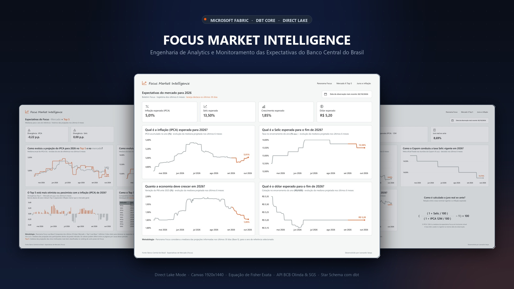
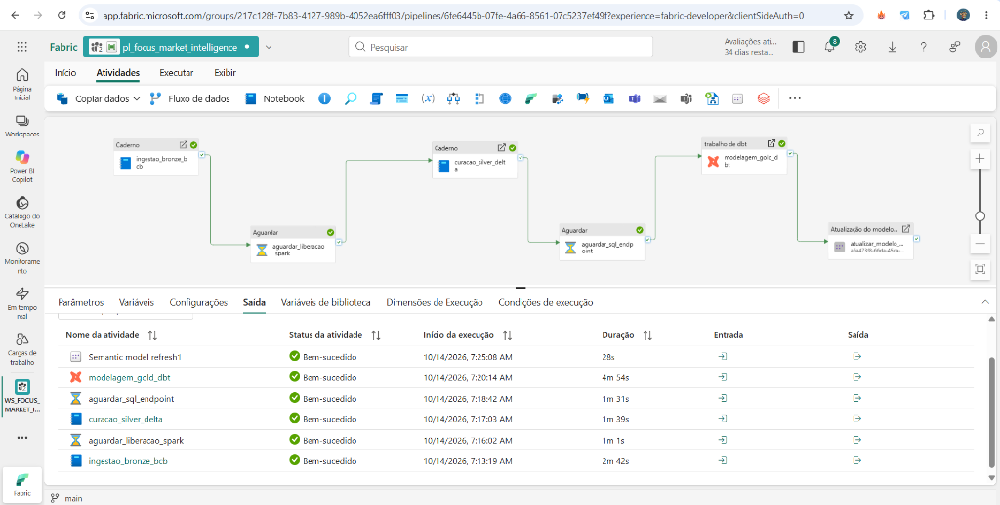
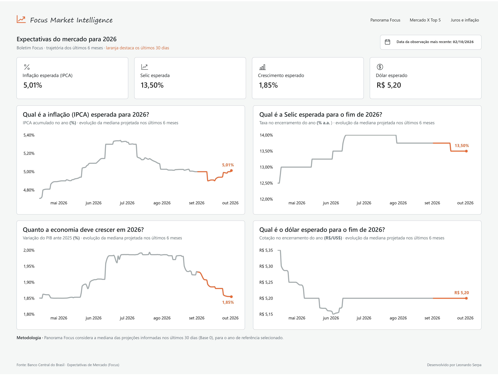
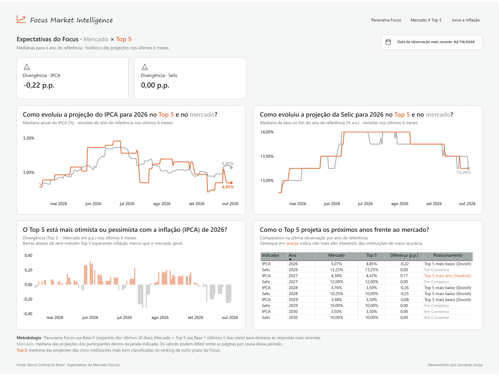
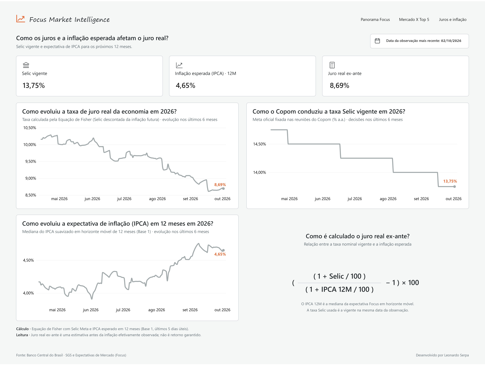

# Focus Market Intelligence

> **Projeto de Analytics Engineering de ponta a ponta no Microsoft Fabric e dbt para monitoramento e modelagem das expectativas macroeconômicas do Banco Central do Brasil (BCB).**

**Português** | [English](./README.en.md)

[](https://fabric.microsoft.com/)
[](https://getdbt.com/)
[](https://powerbi.microsoft.com/)
[](https://spark.apache.org/)
[](https://dadosabertos.bcb.gov.br/)
[](./LICENSE)



---

## Visão Geral do Projeto

O **Focus Market Intelligence** é um projeto prático de Engenharia de Analytics desenvolvido para coletar, estruturar e modelar dados públicos das APIs do Banco Central do Brasil, transformando projeções macroeconômicas (IPCA, Selic, PIB e Câmbio) em análises visuais acessíveis e servindo como referência de implementação de ponta a ponta com Microsoft Fabric, dbt e Power BI.

O projeto resolve três desafios centrais:
1. **Automação Contínua:** Ingestão diária automatizada de expectativas via API Olinda (OData) e taxas oficiais via SGS Séries Temporais.
2. **Governança com Medallion e dbt:** Tratamento progressivo da qualidade dos dados e modelagem dimensional estrela com testes rigorosos de integridade.
3. **Storytelling Executivo e Rigor Econômico:** Relatório no Power BI com design sóbrio (1920x1440), aplicação da **Equação de Fisher** sem aproximações lineares distorcidas e análise comparativa institucional entre o **Consenso Geral** e o grupo **Top 5**.

---

## Arquitetura de Dados End-to-End

```mermaid
flowchart LR
    subgraph Ingestao ["1. Ingestão e Fontes"]
        A[API BCB Olinda OData]
        B[API SGS Série 432]
    end

    subgraph FabricLakehouse ["2. Lakehouse Medallion"]
        C[nb_01_raw_to_bronze]
        D[(Bronze Delta Lake)]
        W1["aguardar_liberacao_spark<br/>(Buffer 60s)"]
        E[nb_02_bronze_to_silver]
        F[(Silver Delta Lake)]
        W2["aguardar_sql_endpoint<br/>(Buffer 90s)"]
    end

    subgraph FabricWarehouse ["3. Warehouse e dbt"]
        G[dbt Core Job]
        H[(Gold Star Schema)]
    end

    subgraph Consumo ["4. Consumo e BI"]
        R["refresh_modelo_semantico<br/>(Direct Lake Refresh)"]
        I[Modelo Semântico Direct Lake]
        J[Power BI Report 3 Páginas]
    end

    A --> C
    B --> C
    C --> D
    D --> W1
    W1 --> E
    E --> F
    F --> W2
    W2 --> G
    G --> H
    H --> R
    R --> I
    I --> J
```



### Orquestração Automatizada no Microsoft Fabric Data Pipeline

A esteira completa de engenharia de dados é orquestrada pelo pipeline `pl_focus_market_intelligence`, contendo 6 atividades automatizadas de ponta a ponta:

1. **`ingestao_bronze_bcb`**: Notebook PySpark que consome as APIs Olinda e SGS do Banco Central.
2. **`aguardar_liberacao_spark`**: Espera de 60s para desalocação de nós Spark e prevenção de contenção de capacidade (HTTP 430).
3. **`curacao_silver_delta`**: Notebook PySpark de limpeza, tipagem e deduplicação Delta.
4. **`aguardar_sql_endpoint`**: Espera de 90s para indexação e sincronização de metadados no SQL Analytics Endpoint.
5. **`modelagem_gold_dbt`**: Job do dbt Core executando `dbt build` no Warehouse via T-SQL.
6. **`refresh_modelo_semantico`**: Atualização nativa do modelo semântico para invalidação do cache Direct Lake.



### Modelo Semântico Direct Lake (Star Schema)

As tabelas dimensionais e de fatos geradas pelo dbt no Fabric Warehouse são consumidas pelo modelo semântico `sm_focus_market_intelligence` em modo **Direct Lake**, organizadas em um Esquema Estrela puro:


---

## Estrutura do Dashboard (3 Painéis Executivos)

O relatório Power BI é estruturado em três telas complementares em canvas 1920x1440:

### 1. Página 1: Panorama Focus
* Visão macro ampla dos 4 pilares da economia: **IPCA**, **Taxa Selic**, **PIB** e **Câmbio (USD/BRL)** para 2026.
* Trajetória histórica dos últimos 6 meses com destaque em laranja para a aceleração dos **últimos 30 dias** (janela oficial de apuração do BCB).
* Matriz de projeções plurianuais e variações de consenso.



### 2. Página 2: Mercado x Top 5
* Comparativo institucional entre o **Consenso Geral do Mercado** e as **Top 5** (as 5 instituições com maior taxa de acerto histórico no ranking do BCB).
* Análise de divergência com gráficos de dispersão condicional: identificação de viés **Hawkish** (laranja) vs **Dovish** (cinza grafite).
* Cards de dispersão pontual com variações em pontos percentuais (Delta p.p.).



### 3. Página 3: Juros e Inflação (Juro Real Ex-Ante)
* Monitoramento da política monetária do Copom (Selic Vigente diária) e da expectativa de inflação suavizada em 12 meses (IPCA 12M).
* Cálculo da taxa de **Juro Real Ex-Ante** calculada rigorosamente pela **Equação de Fisher**:
  $$\text{Juro Real Ex-Ante} = \left( \frac{1 + \frac{\text{Selic}}{100}}{1 + \frac{\text{IPCA}_{12M}}{100}} - 1 \right) \times 100$$
* Bloco metodológico pedagógico explicando a formulação matemática e notas analíticas de leitura de mercado.



---

## Documentação Técnica Completa (Diátaxis Framework)

A documentação aprofundada deste repositório foi construída seguindo a metodologia técnica **Diátaxis** e está disponível em dois idiomas:

| Quadrante | Documento (PT-BR) | Conteúdo |
| :--- | :--- | :--- |
| **Tutorial** | [Guia de Inicialização](./docs/pt-br/tutoriais/primeiros-passos.md) | Passo a passo para configurar o Workspace no Fabric e rodar a esteira do zero. |
| **Guia Prático** | [Executar Modelos dbt](./docs/pt-br/guias-praticos/executar-pipeline-dbt.md) | Como compilar modelos, rodar `dbt build` e validar testes de qualidade. |
| **Guia Prático** | [Integração Git no Fabric](./docs/pt-br/guias-praticos/sincronizacao-git-fabric.md) | Como versionar artefatos do Fabric e criar commits atômicos no GitHub. |
| **Referência** | [Dicionário de Dados](./docs/pt-br/referencia/dicionario-de-dados.md) | Especificação das tabelas Bronze, Silver e Gold, tipos e relacionamentos. |
| **Referência** | [Catálogo de Medidas DAX](./docs/pt-br/referencia/catalogo-medidas-dax.md) | Fórmulas DAX, Equação de Fisher, cálculo de spreads e formatações. |
| **Explicação** | [Arquitetura Fabric e Direct Lake](./docs/pt-br/explicacao/arquitetura-fabric.md) | Decisões técnicas: Medallion, dbt no Warehouse e Direct Lake. |
| **Explicação** | [Metodologia Focus e Fisher](./docs/pt-br/explicacao/metodologia-focus-e-fisher.md) | Apuração do BCB (Base 0 e Base 1) e matemática da taxa real. |

*(Para a suíte de documentação em inglês, consulte [docs/en/README.md](./docs/en/README.md) ou [README.en.md](./README.en.md))*.

---

## Estrutura de Diretórios

```text
focus-market-intelligence/
├── README.md                      # Vitrine em Português
├── README.en.md                   # Vitrine em Inglês
├── LICENSE                        # Licença MIT
├── docs/                          # Documentação técnica Diátaxis (Bilíngue)
│   ├── assets/screenshots/        # Capturas dos 3 painéis executivos
│   ├── README.md                  # Seletor de idioma
│   ├── pt-br/                     # Documentação em Português
│   │   └── README.md              # Índice Diátaxis em Português
│   └── en/                        # Documentação em Inglês
│       └── README.md              # Índice Diátaxis em Inglês
└── fabric/                        # Artefatos sincronizados com o Microsoft Fabric
    ├── 01 - Lakehouse/            # lk_focus_intelligence (Delta Lake)
    ├── 02 - Notebooks/            # nb_01_raw_to_bronze, nb_02_bronze_to_silver
    ├── 03 - Pipelines/            # pl_focus_market_intelligence (Data Pipeline)
    ├── 04 - Warehouse/            # wh_focus_intelligence (SQL Server / T-SQL)
    ├── 05 - dbt/                  # dbt_focus_intelligence (Modelos dimensionais)
    ├── 06 - Semantic Models/      # sm_focus_market_intelligence (TMDL / Direct Lake)
    └── 07 - Reports/              # rpt_focus_market_intelligence (PBIP Power BI)
```

---

## Autor

**Leonardo Serpa**