# Explanation: Data Architecture in Microsoft Fabric

This document discusses architectural and conceptual design decisions behind the **Focus Market Intelligence** platform, explaining technical motivations for selecting **Microsoft Fabric**, **dbt**, and **Direct Lake** storage mode.

---

## The Microsoft Fabric and OneLake Paradigm

Traditionally, building an end-to-end analytical pipeline involving government API ingestion, heavy data processing, dimensional modeling, and interactive BI required stitching together multiple cloud services:
* Azure Data Factory (orchestration)
* Azure Databricks or Synapse Spark (distributed processing)
* Azure SQL or Snowflake (data warehousing)
* Power BI Service (semantic models & visualization)

**Microsoft Fabric** consolidates these capabilities into a single SaaS platform unified by **OneLake** (the unified analytical data lake). Every compute engine natively reads and writes open-format **Delta Lake (Parquet with transaction logs)**, eliminating data silos and redundant copies.

---

## Medallion Architecture (Bronze -> Silver -> Gold)

We implement the standard Medallion Architecture to ensure data governance, progressive quality elevation, and complete auditability:

```mermaid
flowchart LR
    subgraph Bronze ["1. Bronze Layer (Raw)"]
        direction TB
        B1["PySpark Notebook<br/>nb_01_raw_to_bronze"]
        B2[("Lakehouse Delta Lake<br/>lk_focus_intelligence")]
        B1 --> B2
    end

    subgraph Silver ["2. Silver Layer (Curated)"]
        direction TB
        S1["PySpark Notebook<br/>nb_02_bronze_to_silver"]
        S2[("Lakehouse Delta Lake<br/>silver_*")]
        S1 --> S2
    end

    subgraph Gold ["3. Gold Layer (Dimensional)"]
        direction TB
        G1["dbt Core Job<br/>T-SQL / dbt build"]
        G2[("Fabric Warehouse<br/>wh_focus_intelligence")]
        G1 --> G2
    end

    subgraph Consumption ["4. Semantic & BI Layer"]
        direction TB
        R1["Semantic Model Refresh<br/>Direct Lake Invalidation"]
        R2["Power BI Report (PBIP)<br/>sm_focus_market_intelligence"]
        R1 --> R2
    end

    B2 --> W1["aguardar_liberacao_spark<br/>Wait 60s (Spark Buffer)"]
    W1 --> S1
    S2 --> W2["aguardar_sql_endpoint<br/>Wait 90s (SQL Endpoint Buffer)"]
    W2 --> G1
    G2 --> R1
```

### 1. Bronze Layer (Raw)
* **Goal:** Capture raw payloads from Central Bank APIs (Olinda OData and SGS series) exactly as emitted by source endpoints, preserving full history.
* **Tool:** PySpark Notebooks (`nb_01_raw_to_bronze`).
* **Rationale:** In the event of schema shifts or regulatory re-audit, raw source files remain preserved in Delta Lake for zero-loss recomputation.

### 2. Silver Layer (Curated and Standardized)
* **Goal:** Perform type coercion, timestamp parsing, null handling, deduplication, and indicator normalization.
* **Tool:** PySpark Notebooks (`nb_02_bronze_to_silver`).
* **Rationale:** Apache Spark scales memory processing across historical series, enforcing formal schemas and temporal validations.

### 3. Gold Layer (Dimensional Star Schema)
* **Goal:** Deliver normalized facts and dimensions optimized for analytical queries.
* **Tool:** Fabric Data Warehouse orchestrated by **dbt** (`dbt_focus_intelligence`).
* **Rationale:** Enables standard SQL modeling, surrogate key generation (`data_sk`), clean joins, and referential integrity assertions.

---

## Why dbt (Data Build Tool) Inside Fabric Warehouse?

Gold layer transformations are maintained in **dbt** for four essential reasons:
1. **Analytics Code as Software:** All models are declarative, version-controlled SQL files tracked in Git.
2. **Automated DAG Lineage:** dbt infers execution ordering automatically through `ref()` and `source()` macros.
3. **Automated Assertion Testing:** Models enforce schema tests (`schema.yml`) validating uniqueness, non-nullability, and referential constraints prior to report consumption.
4. **Idempotent Deployments:** Table materialization guarantees deterministic, atomic builds on each run.

---

## Direct Lake: Overcoming the Import vs. DirectQuery Dilemma

The semantic model `sm_focus_market_intelligence` accesses Gold Warehouse tables via **Direct Lake**:

* **Traditional Import Mode:** Incurs data duplication, memory footprint constraints, and scheduled refresh latency.
* **Traditional DirectQuery:** Translates visual interactions into live SQL queries, resulting in query latency and database load.
* **Fabric Direct Lake:** Reads columnar Parquet files directly from OneLake storage at in-memory speeds **without duplicating data into memory caches**, ensuring instant freshness upon pipeline completion.

---

## Operational Lineage in Microsoft Fabric (Lineage View)

Below is the actual operational lineage graph of the artifacts within the Microsoft Fabric workspace:

### Understanding the Lineage Topology and the 6 Pipeline Stages

Reviewing the Fabric pipeline and lineage highlights three foundational architectural pillars:

1. **Pipeline Orchestration (`pl_focus_market_intelligence`):** The pipeline commands 6 automated, sequential activities:
   * **`ingestao_bronze_bcb`**: PySpark ingestion pulling Central Bank APIs into Bronze Delta tables.
   * **`aguardar_liberacao_spark`**: 60-second stabilization buffer for clean Spark compute deallocation and HTTP 430 capacity throttling prevention.
   * **`curacao_silver_delta`**: PySpark curation, typing, deduplication, and quality enforcement into Silver Delta.
   * **`aguardar_sql_endpoint`**: 90-second wait buffer ensuring asynchronous Delta metadata indexing on the Lakehouse SQL Analytics Endpoint prior to dbt queries.
   * **`modelagem_gold_dbt`**: Dimensional star schema compilation and assertions via dbt Core connected to Warehouse over T-SQL.
   * **`refresh_modelo_semantico`**: Native semantic model refresh activity invalidating Direct Lake cache on `sm_focus_market_intelligence`.
2. **dbt T-SQL Materialization:** dbt connects to the Data Warehouse (`wh_focus_intelligence`) via standard T-SQL database connections to materialize Gold tables. The Fabric visual lineage tracker does not introspect external dynamic SQL executions as declarative UI dependencies.
3. **Direct Lake Cache Invalidation:** While Direct Lake streams Delta/Parquet files directly without duplication, the in-memory tabular engine maintains pointers to earlier transaction snapshots. The final semantic model refresh activity invalidates this cache instantaneously (~28s), guaranteeing that all visual cards and charts immediately reflect the newest observations without requiring manual page reloads or polling.

### Operational Pipeline Execution

Below is the execution evidence of the 6 sequential activities passing successfully in Microsoft Fabric:

