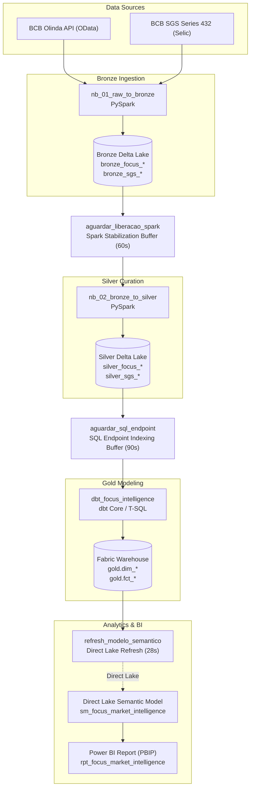

# Reference: Data Dictionary and Schema Architecture

This document provides the formal technical specification for all tables, columns, data types, and integration contracts across the **Medallion Architecture** in the **Focus Market Intelligence** platform.

---

## Data Lineage

#### Operational Workspace Lineage (Lineage View)

---

## 1. Bronze Layer (Raw Ingestion)

Persisted inside Lakehouse `lk_focus_intelligence` as raw Delta Lake tables:

* **`bronze_focus_anuais`**: Raw payload from the `ExpectativasMercadoAnuais` endpoint of the BCB Olinda OData API.
* **`bronze_focus_top5_anuais`**: Raw payload from the `ExpectativasMercadoTop5Anuais` endpoint.
* **`bronze_focus_inflacao_12m`**: Raw payload from `ExpectativasMercadoInflacao12Meses` (12-month smoothed rolling expectations).
* **`bronze_sgs_selic_meta`**: Raw time series 432 from the Central Bank Time Series Management System (SGS).

---

## 2. Silver Layer (Curated and Typed Tables)

Processed by notebook `nb_02_bronze_to_silver` inside Lakehouse `lk_focus_intelligence`:

### 2.1 `silver_focus_anuais`
Cleaned market expectations across core indicators (IPCA, Selic, Exchange Rate, and Total GDP).
* `data` (DATE): Observation date submitted by reporting institutions.
* `indicador` (VARCHAR): Standardized indicator name (`IPCA`, `Selic`, `Câmbio`, `PIB Total`).
* `ano_referencia` (INT): Forecast target year (e.g., `2026`).
* `base_calculo` (INT): Calculation window (`0` for 30 calendar days; `1` for 5 business days).
* `mediana` (DECIMAL(10,4)): Statistical median of respondent projections.
* `media` (DECIMAL(10,4)): Weighted arithmetic mean.
* `desvio_padrao` (DECIMAL(10,4)): Standard deviation across forecasts.
* `coeficiente_variacao` (DECIMAL(10,4)): Ratio of standard deviation to mean.

### 2.2 `silver_focus_top5_anuais`
Annual projections exclusive to the 5 financial institutions holding top accuracy rankings.
* `data` (DATE): Projection record date.
* `indicador` (VARCHAR): Indicator (`IPCA`, `Selic`, `Câmbio`).
* `ano_referencia` (INT): Target year.
* `tipo_calculo` (VARCHAR): `C` for short-term accuracy ranking, `M` for medium-term.
* `mediana` (DECIMAL(10,4)): Top 5 group median.

### 2.3 `silver_focus_inflacao_12m`
Smoothed 12-month forward rolling IPCA inflation expectations.
* `data` (DATE): Observation date.
* `indicador` (VARCHAR): `IPCA`.
* `base_calculo` (INT): Most recent base (1 = 5 business days).
* `mediana` (DECIMAL(10,4)): Median 12-month expected inflation.
* `media` (DECIMAL(10,4)): Weighted mean.
* `desvio_padrao` (DECIMAL(10,4)): Forecast dispersion.

### 2.4 `silver_sgs_selic_meta`
Official target Selic rate decided by the Copom committee from SGS series 432.
* `data` (DATE): Effective date.
* `taxa_selic_meta_aa` (DECIMAL(10,4)): Annualized nominal rate (% p.a.).

---

## 3. Gold Layer (Dimensional Data Warehouse)

Persisted inside Data Warehouse `wh_focus_intelligence` under the `gold` schema, materialized by dbt and consumed via **Direct Lake** structured as a clean Star Schema:

### 3.1 `dim_calendario` (Time Dimension)
Continuous daily calendar from 2000-01-01 through 2035-12-31.
* `data_sk` (INT, PK): Surrogate integer key formatted as `yyyyMMdd` (e.g., `20261002`).
* `data` (DATE, Unique): Standard calendar date.
* `ano` (INT): Calendar year.
* `trimestre` (INT): Calendar quarter (1 to 4).
* `mes` (INT): Month number (1 to 12).
* `mes_nome` (VARCHAR): Abbreviated month name (e.g., `out`).
* `dia` (INT): Day of month (1 to 31).
* `dia_semana` (INT): Day of week (1 = Sunday, 7 = Saturday).
* `fl_dia_util` (BIT): Business day flag (`1` for banking day, `0` for weekend/holiday).

### 3.2 `dim_indicador` (Metadata Dimension)
* `indicador_id` (INT, PK): Unique surrogate identifier.
* `indicador` (VARCHAR, Unique): Indicator name (`IPCA`, `Selic`, `Câmbio`, `PIB Total`).
* `unidade_medida` (VARCHAR): `% a.a.` for rates/percentages; `R$/US$` for exchange rates.

### 3.3 `fct_expectativas_mercado` (Market Panorama Fact)
* `data_sk` (INT, FK -> `dim_calendario.data_sk`): Time surrogate key.
* `data` (DATE): Observation date.
* `indicador` (VARCHAR, FK -> `dim_indicador.indicador`): Indicator name.
* `ano_referencia` (INT): Forecast reference year (2026 to 2030).
* `mediana` (FLOAT): Broad market consensus median.
* `media` (FLOAT): Arithmetic mean.
* `desvio_padrao` (FLOAT): Dispersion across respondent forecasts.

### 3.4 `fct_comparativo_top5` (Market vs. Top 5 Fact)
* `data_sk` (INT, FK -> `dim_calendario.data_sk`): Time surrogate key.
* `data` (DATE): Observation date.
* `indicador` (VARCHAR, FK -> `dim_indicador.indicador`): Indicator.
* `ano_referencia` (INT): Target year.
* `mediana_mercado` (FLOAT): Overall market consensus.
* `mediana_top5` (FLOAT): Top 5 group median.
* `divergencia` (FLOAT): Mathematical spread `(mediana_top5 - mediana_mercado)`.
* `spread_pp` (FLOAT): Divergence expressed in percentage points (p.p.).

### 3.5 `fct_juro_real_ex_ante` (Real Rate and Fisher Fact)
* `data_sk` (INT, FK -> `dim_calendario.data_sk`): Time surrogate key.
* `data` (DATE): Simultaneous observation date.
* `taxa_selic_meta_aa` (FLOAT): Effective Copom Selic rate on that date.
* `ipca_esperado_12m` (FLOAT): Median 12-month forward smoothed inflation (Base 1).
* `desvio_padrao_ipca_12m` (FLOAT): Inflation forecast uncertainty.
* `taxa_juro_real_ex_ante` (FLOAT): Ex-ante real interest rate calculated via the **Fisher Equation**:
  $$\text{Real Rate Ex-Ante} = \left( \frac{1 + \frac{\text{Selic}}{100}}{1 + \frac{\text{IPCA}_{12M}}{100}} - 1 \right) \times 100$$
