# Explicação: Arquitetura de Dados no Microsoft Fabric

Este documento discute as decisões conceituais e arquiteturais do projeto **Focus Market Intelligence**, explicando as motivações técnicas por trás da escolha do **Microsoft Fabric**, do framework **dbt** e do modo **Direct Lake**.

---

## A Filosofia do Microsoft Fabric e OneLake

Tradicionalmente, a construção de uma solução analítica com ingestão de APIs governamentais, transformação pesada de dados, modelagem dimensional e BI exigiria a contratação e integração de múltiplos serviços em nuvem:
* Azure Data Factory (orquestração)
* Azure Databricks ou Synapse Spark (processamento)
* Azure SQL ou Snowflake (data warehouse)
* Power BI Service (camada semântica e relatórios)

O **Microsoft Fabric** unifica todas essas capacidades sob uma única plataforma SaaS baseada no **OneLake** (o armazenamento unificado de dados). Todas as camadas utilizam o formato aberto **Delta Lake (Parquet com transaction logs)**, eliminando silos de dados e cópias redundantes.

---

## A Arquitetura Medallion (Bronze -> Silver -> Gold)

Adotamos a arquitetura Medallion para garantir governança, qualidade progressiva e rastreabilidade:

```mermaid
flowchart LR
    subgraph Bronze ["1. Camada Bronze (Raw)"]
        direction TB
        B1["PySpark Notebook<br/>nb_01_raw_to_bronze"]
        B2[("Lakehouse Delta Lake<br/>lk_focus_intelligence")]
        B1 --> B2
    end

    subgraph Silver ["2. Camada Silver (Curada)"]
        direction TB
        S1["PySpark Notebook<br/>nb_02_bronze_to_silver"]
        S2[("Lakehouse Delta Lake<br/>silver_*")]
        S1 --> S2
    end

    subgraph Gold ["3. Camada Gold (Dimensional)"]
        direction TB
        G1["dbt Core Job<br/>T-SQL / dbt build"]
        G2[("Fabric Warehouse<br/>wh_focus_intelligence")]
        G1 --> G2
    end

    subgraph Consumo ["4. Camada Semântica & BI"]
        direction TB
        R1["Semantic Model Refresh<br/>Invalidação Direct Lake"]
        R2["Power BI Report (PBIP)<br/>sm_focus_market_intelligence"]
        R1 --> R2
    end

    B2 --> W1["aguardar_liberacao_spark<br/>Espera 60s (Buffer Spark)"]
    W1 --> S1
    S2 --> W2["aguardar_sql_endpoint<br/>Espera 90s (Buffer SQL Endpoint)"]
    W2 --> G1
    G2 --> R1
```

### 1. Camada Bronze (Raw)
* **Objetivo:** Ingerir os dados brutos das APIs do Banco Central (Olinda OData e SGS) exatamente como entregues pela fonte, sem transformações destrutivas.
* **Ferramenta:** Notebooks PySpark (`nb_01_raw_to_bronze`).
* **Justificativa:** Se houver mudança de regras de negócio ou necessidade de auditoria histórica, os dados brutos estão preservados no Delta Lake para reprocessamento a qualquer momento.

### 2. Camada Silver (Curada e Padronizada)
* **Objetivo:** Limpeza, tipagem correta de dados, tratamento de nulos, deduplicação e padronização de nomenclatura de indicadores.
* **Ferramenta:** Notebooks PySpark (`nb_02_bronze_to_silver`).
* **Justificativa:** O Spark garante escalabilidade para processar grandes séries temporais históricas em memória, aplicando esquemas formais e validação de datas.

### 3. Camada Gold (Modelo Estrela Dimensional)
* **Objetivo:** Estruturação em Modelo Estrela (*Star Schema*) com fatos e dimensões normalizadas, prontas para consumo analítico de alta performance.
* **Ferramenta:** Fabric Data Warehouse gerenciado pelo **dbt** (`dbt_focus_intelligence`).
* **Justificativa:** Permite consultas analíticas com SQL padrão, cálculo de surrogates keys (`data_sk`), joins consistentes e testes formais de integridade referencial.

---

## Por que dbt (Data Build Tool) no Fabric Warehouse?

A modelagem da camada Gold é executada via **dbt** pelos seguintes motivos:
1. **Engenharia de Analytics como Código:** Todos os modelos são arquivos SQL declarativos versionados no Git.
2. **DAG Automatizado:** O dbt infere automaticamente a ordem de execução dos modelos a partir das funções `ref()` e `source()`.
3. **Testes Automatizados:** Cada modelo possui testes de unicidade, nulidade e relacionamentos definidos em YAML (`schema.yml`). Se um teste falhar, a esteira alerta a quebra antes que o relatório seja impactado.
4. **Idempotência:** A materialização como `table` garante que as tabelas sejam recriadas de forma atômica e consistente em cada execução.

---

## Direct Lake: O Fim do Dilema Import vs DirectQuery

O modelo semântico `sm_focus_market_intelligence` consome as tabelas do Warehouse em modo **Direct Lake**:

* **Import Mode tradicional:** Exige que os dados sejam copiados e comprimidos na memória do Power BI, gerando latência de atualização e limites de capacidade.
* **DirectQuery tradicional:** Traduz interações visuais em queries SQL ao vivo, gerando lentidão e sobrecarga computacional no banco.
* **Direct Lake do Fabric:** Lê diretamente os arquivos colunares Parquet do OneLake na velocidade da memória RAM, sem carregar os dados duas vezes e com atualização instantânea após o processamento do dbt.

---

## Linhagem Operacional no Microsoft Fabric (Lineage View)

Abaixo está a exibição real de linhagem operacional dos artefatos dentro do workspace no Microsoft Fabric:

### Compreendendo a Topologia e as 6 Etapas do Pipeline

Ao analisar a esteira completa e a orquestração do Fabric, observam-se três características arquiteturais centrais:

1. **Orquestração pelo Pipeline (`pl_focus_market_intelligence`):** A pipeline comanda a execução sequencial de 6 atividades automatizadas:
   * **`ingestao_bronze_bcb`**: Ingestão Spark das APIs do BCB no Lakehouse Bronze.
   * **`aguardar_liberacao_spark`**: Espera de 60s para desalocação de nós Spark e prevenção de contenção de capacidade (HTTP 430).
   * **`curacao_silver_delta`**: Curadoria e enriquecimento Spark no Lakehouse Silver Delta.
   * **`aguardar_sql_endpoint`**: Espera de 90s para sincronização assíncrona dos metadados Delta no SQL Analytics Endpoint do Lakehouse antes da execução do dbt.
   * **`modelagem_gold_dbt`**: Materialização dimensional Gold via dbt Core conectado ao Warehouse por T-SQL.
   * **`refresh_modelo_semantico`**: Invalidação nativa de cache Direct Lake e refresh do modelo semântico (`sm_focus_market_intelligence`).
2. **Materialização T-SQL do dbt:** O dbt se conecta ao Data Warehouse (`wh_focus_intelligence`) via T-SQL para materializar as tabelas Gold. Como essa operação é realizada por conexão de banco de dados, o motor visual do Fabric não rastreia comandos SQL dinâmicos como dependências declarativas de interface.
3. **Invalidação e Atualização no Direct Lake:** Embora o Direct Lake leia arquivos Delta/Parquet sem importação tradicional, os metadados em memória do modelo semântico retêm ponteiros para snapshots anteriores. A atividade final de atualização do modelo semântico (*Semantic Model Refresh*) invalida o cache instantaneamente (~28s), garantindo que as páginas do relatório exibam as datas e valores mais recentes imediatamente após a conclusão da carga.

### Execução Operacional do Pipeline de Dados

Abaixo, a evidência de execução bem-sucedida das 6 atividades sequenciais orquestradas no Microsoft Fabric:

