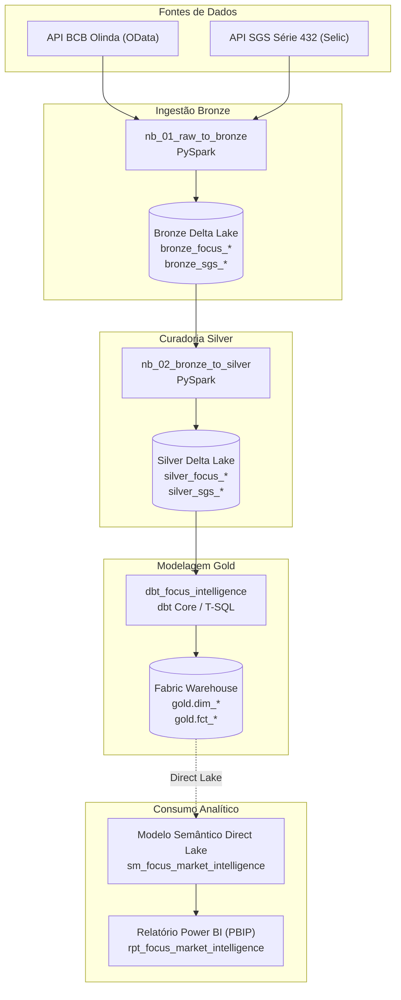

# Referência: Dicionário de Dados e Arquitetura de Schemas

Este documento fornece a especificação técnica formal de todas as tabelas, colunas, tipos de dados e contratos de integração da arquitetura **Medallion** no projeto **Focus Market Intelligence**.

---

## Linhagem de Dados (Data Lineage)

---

## 1. Camada Bronze (Ingestão Raw)

Armazenada no Lakehouse `lk_focus_intelligence` no formato Delta Lake:

* **`bronze_focus_anuais`**: Ingestão bruta do endpoint `ExpectativasMercadoAnuais` da API Olinda (BCB).
* **`bronze_focus_top5_anuais`**: Ingestão bruta do endpoint `ExpectativasMercadoTop5Anuais`.
* **`bronze_focus_inflacao_12m`**: Ingestão bruta de `ExpectativasMercadoInflacao12Meses` (horizonte móvel suavizado).
* **`bronze_sgs_selic_meta`**: Ingestão bruta da série temporal 432 do Sistema Gerenciador de Séries Temporais (SGS) do Banco Central.

---

## 2. Camada Silver (Tabelas Curadas e Tipadas)

Tabelas tratadas pelo notebook `nb_02_bronze_to_silver` no Lakehouse `lk_focus_intelligence`:

### 2.1 `silver_focus_anuais`
Contém as expectativas de mercado limpas para os indicadores macroeconômicos principais (IPCA, Selic, Câmbio e PIB).
* `data` (DATE): Data da observação informada pelo participante.
* `indicador` (VARCHAR): Nome do indicador padronizado (`IPCA`, `Selic`, `Câmbio`, `PIB Total`).
* `ano_referencia` (INT): Ano para o qual a projeção se destina (ex: `2026`).
* `base_calculo` (INT): `0` para cálculo em janela de 30 dias corridos; `1` para janela de 5 dias úteis.
* `mediana` (DECIMAL(10,4)): Mediana estatística das projeções dos participantes.
* `media` (DECIMAL(10,4)): Média das projeções.
* `desvio_padrao` (DECIMAL(10,4)): Dispersão das estimativas.
* `coeficiente_variacao` (DECIMAL(10,4)): Relação entre desvio padrão e média.

### 2.2 `silver_focus_top5_anuais`
Expectativas anuais exclusivas das 5 instituições financeiras com melhor índice de acerto no ranking do BCB.
* `data` (DATE): Data de registro da projeção.
* `indicador` (VARCHAR): Indicador (`IPCA`, `Selic`, `Câmbio`).
* `ano_referencia` (INT): Ano projetado.
* `tipo_calculo` (VARCHAR): `C` para projeções de curto prazo, `M` para médio prazo.
* `mediana` (DECIMAL(10,4)): Mediana do grupo Top 5.

### 2.3 `silver_focus_inflacao_12m`
Expectativa de IPCA acumulado para os próximos 12 meses em horizonte móvel suavizado.
* `data` (DATE): Data da observação.
* `indicador` (VARCHAR): `IPCA`.
* `base_calculo` (INT): Base mais recente (1 = 5 dias úteis).
* `mediana` (DECIMAL(10,4)): Mediana da expectativa de inflação futura em 12 meses.
* `media` (DECIMAL(10,4)): Média ponderada.
* `desvio_padrao` (DECIMAL(10,4)): Dispersão da expectativa.

### 2.4 `silver_sgs_selic_meta`
Taxa Selic Meta oficial fixada pelo Copom na série SGS 432.
* `data` (DATE): Data de vigência da taxa.
* `taxa_selic_meta_aa` (DECIMAL(10,4)): Taxa nominal anualizada (% a.a.).

---

## 3. Camada Gold (Data Warehouse Dimensional)

Armazenada no Data Warehouse `wh_focus_intelligence` sob o schema `gold` (ou `dbo_gold`), modelada pelo dbt e servida via **Direct Lake**:

### 3.1 `dim_calendario` (Dimensão de Tempo)
Gera um calendário contínuo de 01/01/2000 a 31/12/2035.
* `data_sk` (INT, PK): Chave substituta numérica no formato `yyyyMMdd` (ex: `20261002`).
* `data` (DATE, Unique): Data no formato padrão `yyyy-MM-dd`.
* `ano` (INT): Ano civil (ex: `2026`).
* `trimestre` (INT): Trimestre civil (1 a 4).
* `mes` (INT): Número do mês (1 a 12).
* `mes_nome` (VARCHAR): Nome abreviado do mês (ex: `out`).
* `dia` (INT): Dia do mês (1 a 31).
* `dia_semana` (INT): Dia da semana (1 = Domingo, 7 = Sábado).
* `fl_dia_util` (BIT): Flag binária (`1` para dia útil bancário, `0` para fim de semana/feriado).

### 3.2 `dim_indicador` (Dimensão de Metadados)
* `indicador_id` (INT, PK): Identificador único numérico do indicador.
* `indicador` (VARCHAR, Unique): Nome do indicador (`IPCA`, `Selic`, `Câmbio`, `PIB Total`).
* `unidade_medida` (VARCHAR): `% a.a.` para taxas e variações percentuais; `R$/US$` para cotações cambiais.

### 3.3 `fct_expectativas_mercado` (Fato Panorama Focus)
* `data_sk` (INT, FK -> `dim_calendario.data_sk`): Chave estrangeira temporal.
* `data` (DATE): Data da observação.
* `indicador` (VARCHAR, FK -> `dim_indicador.indicador`): Indicador macroeconômico.
* `ano_referencia` (INT): Ano de referência da estimativa (2026 a 2030).
* `mediana` (FLOAT): Mediana das expectativas do mercado geral.
* `media` (FLOAT): Média das projeções.
* `desvio_padrao` (FLOAT): Dispersão absoluta das estimativas.

### 3.4 `fct_comparativo_top5` (Fato Mercado vs Top 5)
* `data_sk` (INT, FK -> `dim_calendario.data_sk`): Chave estrangeira de data.
* `data` (DATE): Data da observação.
* `indicador` (VARCHAR, FK -> `dim_indicador.indicador`): Indicador econômico.
* `ano_referencia` (INT): Ano de referência.
* `mediana_mercado` (FLOAT): Projeção de consenso do mercado geral.
* `mediana_top5` (FLOAT): Projeção do grupo Top 5.
* `divergencia` (FLOAT): Diferença matemática `(mediana_top5 - mediana_mercado)`.
* `spread_pp` (FLOAT): Divergência expressa em pontos percentuais (p.p.).

### 3.5 `fct_juro_real_ex_ante` (Fato Juro Real e Fisher)
* `data_sk` (INT, FK -> `dim_calendario.data_sk`): Chave estrangeira temporal.
* `data` (DATE): Data da observação simultânea.
* `taxa_selic_meta_aa` (FLOAT): Taxa Selic Meta fixada pelo Copom vigente na data.
* `ipca_esperado_12m` (FLOAT): Mediana do IPCA suavizado para os próximos 12 meses (Base 1).
* `desvio_padrao_ipca_12m` (FLOAT): Incerteza ou desvio da expectativa de inflação.
* `taxa_juro_real_ex_ante` (FLOAT): Taxa de juro real calculada pela **Equação de Fisher**:
  $$\text{Juro Real Ex-Ante} = \left( \frac{1 + \frac{\text{Selic}}{100}}{1 + \frac{\text{IPCA}_{12M}}{100}} - 1 \right) \times 100$$
